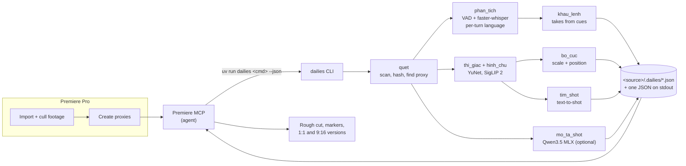

<p align="center">
  
</p>

<p align="center">
  
  
  
  
  <a href="LICENSE"></a>
</p>

**Dailies** (pronounced *DAY-leez*, the editor's word for the day's raw footage) is the on-device "eyes and ears" behind my Premiere Pro and After Effects MCP servers. Point it at a shoot
folder and it listens to the on-set calls ("3, 2, 1, action" ... "cut") to cut rough takes, describes every shot,
lets you search footage with a sentence, and works out scale and position for square and vertical versions. It reads
the proxies you already made in Premiere, so a day of 4K never gets decoded twice, and nothing leaves the machine.

It is a small Python CLI (`uv run dailies <command> --json`) with a stable JSON contract, built to be called by an MCP
server or an agent rather than clicked.

> Command names, flags and JSON keys are in Vietnamese (the language I edit in). They are a frozen contract read by
> the Premiere MCP, so they stay as they are; everything is explained in English below, with a
> [key glossary](#json-key-glossary).

## Features

| Feature | What it does |
|---|---|
| **Cue-based take detection** | Finds takes from voice cues: 3-2-1 countdowns, "action", "rolling", "cut", "okay", "that's good" in English, Spanish ("tres, dos, uno", "acción", "corriendo", "corte", "cortamos") and Vietnamese ("diễn", "đi", "cắt", "được rồi"). Ambiguous words only count when said on their own between pauses. |
| **Per-turn language detection + VAD** | Voice activity detection splits audio into speech turns and Whisper detects the language of each one, so a crew calling cues in Spanish and actors speaking English both come out right. Silence is never transcribed, so no hallucinated "thanks for watching". |
| **Shot description** | Fast mode scores sharpness, exposure, shake and faces, and labels shot size, setting and content with SigLIP 2. Thorough mode adds a local vision LLM (Qwen3.5 on MLX) for a natural sentence per shot. |
| **Footage properties (`thuoc-tinh`)** | Reads every clip before editing, without decoding: size after rotation and pixel aspect, the frame rate and the rate it was shot at (in-camera slow motion, time-lapse), log and HDR (S-Log3 from the XML Sony writes inside the file, which ffprobe reports as unknown; HLG/PQ from colour tags; other log formats from metadata words), variable frame rate, interlacing, codec, bit depth, camera, timecode. Recommends the sequence and fits every other-size clip to frame (4K in Full HD = 50 %). 176 clips in about 20 s. |
| **Footage scoring and selects (`cham-diem`)** | Scores every clip about 4 times per second: sharpness on a 6x6 grid (a sharp subject on a soft background still counts as sharp, shadow noise does not count as detail), exposure, camera motion split into pan, tilt, zoom and roll, shake as jitter around the move (a smooth gimbal move is not shake), flags (black, solid colour, blown out, frozen, cut, flicker, motion blur, low light). Usable stretches become segments with in/out, score and camera move. Kinds: balanced, b-roll, static only. |
| **Fast frame reading** | Decodes only the frames it scores: on all-intra proxies (ProRes, DNxHR) the packets in between are skipped, on H.264/HEVC originals only keyframes are decoded. About 12x faster than decoding every frame on 4K ProRes, 6x on 4K XAVC. |
| **Text-to-shot search** | `tim-shot "a waiter in red"` returns ranked time ranges across all clips, with a peak timestamp for markers. Shot-size jargon ("close-up", "wide shot", in Vietnamese or English) is expanded into phrasings SigLIP understands best. |
| **Framing (`bo-cuc`)** | Scale and position for each take in the target sequence (4K into Full HD, landscape into 9:16), and for turning a finished landscape edit into 1:1 and 9:16 versions that keep your crops, follow faces and never show black edges. |
| **Proxy-first** | Reads audio and frames from the proxies Premiere already made (or the paths the MCP passes in). Missing proxies are reported, not silently re-encoded. |
| **Cache + folder lock** | Results are keyed by a content hash, so reruns are instant and identical. One heavy run per source folder at a time; a second one exits with code 5. |
| **Quiet mode** | By default it runs at macOS background priority on efficiency cores, caps threads at 4 and pauses when the machine is thermally throttled, so you can keep editing. `DAILIES_CHE_DO=nhanh` uses the whole machine. |

## How it fits together



The editor stays in charge of the project: import, cull and proxies happen in Premiere. The MCP then hands Dailies the
clips that survived (with their attached proxies), reads the JSON back and builds sequences, markers and versions.

## Install

Requirements: macOS on Apple Silicon (M1 or later), Python 3.12, [uv](https://docs.astral.sh/uv/), and `ffmpeg` /
`ffprobe` on `PATH` (`brew install ffmpeg`).

```bash
git clone https://github.com/Miinwan/dailies.git
```

```bash
cd dailies && uv sync
```

```bash
uv run dailies --help
```

### Models

Nothing is bundled. Models are downloaded on first use, to the Hugging Face cache (Whisper) or to
`~/Library/Application Support/MCP Adobe/Dailies` (override with `DAILIES_DU_LIEU`).

| Model | Used by | Size | How it gets there |
|---|---|---|---|
| faster-whisper `large-v3` | `take-khau-lenh` | about 3 GB | Downloaded by faster-whisper on first run (`--model` picks another size) |
| SigLIP 2 base patch16-224, ONNX int8 (Apache-2.0) | `mo-ta-shot`, `tim-shot` | about 380 MB | `uv run dailies tai-model --json` |
| YuNet face detector (MIT) | framing, shot scoring | about 230 KB | `uv run dailies tai-model --json` |
| Qwen3.5-2B MLX 4-bit (Apache-2.0) | `mo-ta-shot --che-do ky` | 1.6 GB (0.8B: 0.65 GB) | `uv run dailies cai-mo-ta --model 2b --dong-y --json`, installs mlx-vlm into its own environment |

`cai-mo-ta` without `--dong-y` only asks (exit code 3 with a `cau_hoi` question) so an agent can get your consent
before downloading anything large.

## Usage

Every command takes either a source folder or a clip list, and prints exactly one JSON object to stdout. Progress
and logs go to stderr.

```bash
uv run dailies take-khau-lenh --danh-sach clips.json --json
```

```bash
uv run dailies take-khau-lenh "/Volumes/Shoot/Day1/Source" --khung 9:16 --json
```

`--danh-sach` is the list of clips kept after culling, with the proxy currently attached in the project
(`null` means "look in Premiere's default `Proxies/<name>_Proxy.mov`"):

```json
{"clip": [{"file": "/Volumes/Shoot/Day1/Source/A001.MP4", "proxy": "/Volumes/Shoot/Day1/Source/Proxies/A001_Proxy.mov"},
          {"file": "/Volumes/Shoot/Day1/Source/B004.MP4", "proxy": null}]}
```

More examples:

```bash
uv run dailies mo-ta-shot --danh-sach clips.json --che-do nhanh --json
```

```bash
uv run dailies tim-shot "a girl holding a menu" --danh-sach clips.json --top 5 --json
```

```bash
uv run dailies tim-shot "cận mặt" "/Volumes/Shoot/Day1/Source" --json
```

```bash
uv run dailies thuoc-tinh "/Volumes/Shoot/Day1/Source" --khung 1920x1080 --fps 23.976 --json
```

```bash
uv run dailies cham-diem --danh-sach clips.json --kieu b_roll --json
```

```bash
uv run dailies xuat "/Volumes/Shoot/Day1/Source" --dinh-dang xml,edl,csv --json
```

```bash
uv run dailies doi-chieu-cutdown ~/Library/Application\ Support/com.softworks.cutdown/recovery.cdwn --json
```

```bash
uv run dailies bo-cuc landscape_clips.json --khung 1:1,9:16 --json
```

```bash
DAILIES_CHE_DO=nhanh uv run dailies take-khau-lenh --danh-sach clips.json --json
```

## Commands

| Command | Meaning | What it does | Key options |
|---|---|---|---|
| `take-khau-lenh` | "takes by voice cue" | Transcribes the proxy audio and cuts rough takes between start and end cues, sorted by file name then time, with framing for the target sequence. | `--khung 1920x1080\|9:16` target frame · `--model large-v3` · `--ngon-ngu auto\|vi\|en` · `--fps 25\|29.97\|30000/1001` · `--bo-file-khong-lenh` drop files with no cue |
| `mo-ta-shot` | "describe shot" | One description per source file: quality metrics, SigLIP labels and a sentence (in Vietnamese). | `--che-do nhanh\|ky` fast or thorough · `--so-anh N` frames per shot · `--model 2b\|0.8b` |
| `tim-shot` | "find shot" | Ranks time ranges across all clips against a sentence (Vietnamese or English). | `<query>` · `--top 10` · `--buoc 1` seconds between sampled frames |
| `thuoc-tinh` | "properties" | Reads every clip's properties and recommends the sequence (delivery frame and rate, or the most common) and how each clip goes in: fit to frame, frame-rate relation (judder, possible slow motion), time-lapse, log/HDR, VFR. Writes `.dailies/thuoc_tinh.json`, which `xuat` and the Premiere tools use. | `--khung 1920x1080\|9:16` · `--fps 23.976\|25\|29.97…` |
| `cham-diem` | "score" | Scores every clip and picks usable segments (selects); per-file raw metrics are cached, so a new threshold or kind is instant. 176 clips (58 min of 4K) in 114 s in fast mode. | `--kieu can_bang\|b_roll\|tinh` balanced, b-roll, static only · `--nguong 0.85` threshold · `--ngan-nhat 2` shortest segment (s) · `--noi-khoang 2` bridge dips up to (s) · `--mau-moi-giay 4` |
| `xuat` | "export" | Writes the selects of `cham-diem` for another editor: FCP7 XML (Premiere Pro, DaVinci Resolve), FCPXML (Final Cut Pro), CMX3600 EDL and CSV. Points at the original camera files with their source timecode; the sequence follows the property scan (or `--khung`/`--fps`) and every other-size clip is fit to frame (Basic Motion scale in XML, conform fit in FCPXML); a marker at each peak with score, grade and camera move; clip colour by grade. | `<cham_diem.json or source folder>` · `--dinh-dang xml,fcpxml,edl,csv` · `--ra <folder>` · `--ten <name>` · `--thu-tu file\|diem` · `--khoang` gap · `--dem` handles · `--khung` / `--fps` sequence |
| `doi-chieu-cutdown` | "compare with Cutdown" | Reads a session saved by the Cutdown app (`.cdwn`, format 9) and compares its selects and per-frame scores with `cham-diem` on the same clips, to calibrate. | `<file.cdwn>` · `--ket-qua cham_diem.json` |
| `bo-cuc` | "framing" | Scale and position per clip when turning a landscape sequence into square and vertical versions. | `<clip.json>` · `--khung 1:1,9:16` |
| `tai-model` | "download models" | Downloads SigLIP 2 and YuNet. | |
| `cai-mo-ta` | "install describer" | Installs mlx-vlm and the Qwen3.5 model for thorough mode, after consent. | `--model 2b\|0.8b` · `--dong-y` "I agree" |

Shared options: `--danh-sach <clip.json>` clip list ("list"), `--cho-phep-goc` read originals when a proxy is missing
("allow original"), `--cache <folder>` where to put `.dailies/`, `--json`.

<details>
<summary><b>How take detection decides</b></summary>

- **Start cues:** a 3-2-1 countdown in digits or words ("3, 2, 1", "321", "three, two, one", "tres, dos, uno",
  "ba, hai, một"), "action" / "acción", "rolling" / "corriendo", "diễn", "đi". A cue right after a countdown merges
  into one ("3, 2, 1, action"), and counting "3, 2" straight into the call also counts ("vamos en 3, 2, acción").
- **End cues:** "cut", "okay", "that's good", "corte", "cortamos", "cắt", "ok", "được rồi". A weak end cue ("ok")
  yields to a strong one ("cut") within 10 seconds.
- Words that also show up in dialogue only count when standing alone between pauses of at least 0.3 s. Countdowns,
  "action" and "rolling" count anywhere.
- "Rolling" followed by another start cue (with no end cue in between) yields, because crews often roll, slate and
  adjust before calling action.
- A take starts 0.1 s after the start cue and ends 0.05 s before the end cue. Without an end cue it runs to the next
  start cue or the end of the file, with trailing silence trimmed to 0.3 s.
- Files with no cue at all (B-roll, no audio) are kept whole as one take with `ca_file: true` and confidence 0, so the
  rough cut covers everything. `--bo-file-khong-lenh` drops them.
- Speech turns under 2 s are re-transcribed with surrounding context. Prompting Whisper with the cue words was tried
  and rejected: it copies the prompt into ambiguous turns and invents cues.

</details>

<details>
<summary><b>How square and vertical framing works</b></summary>

The landscape frame, after your own scale, position, anchor point and Crop, is treated as the source image. Each new
version is a window of that image scaled to fill the new frame, so the pixels match the landscape cut and never reveal
anything you cropped out. The window stays inside the clip's visible area, shifts to put a detected face in the
horizontal centre at 40% of the frame height, and otherwise centres on the visible area.

new scale = landscape scale × `he_so_phong` · new position = (landscape position − window corner) × `he_so_phong`

This holds for any anchor point, so the MCP only replaces Scale and Position and keeps Anchor Point, Rotation and
Crop. A pixel-rendering test covers 24 cases (fit, zoom and move, changed anchor, Crop, face inside or outside the
frame, no face, square and vertical): no black edges and under 3 grey levels of difference from the landscape cut.
Rotated clips are returned with a warning.

</details>

## Output

Each command prints one JSON object and also writes it next to the footage in `<source>/.dailies/` (for example
`.dailies/take_khau_lenh.json`). A trimmed `take-khau-lenh` result:

```json
{
  "ok": true,
  "phien_ban": "1",
  "thu_muc": "/Volumes/Shoot/Day1/Source",
  "model": "large-v3",
  "khung": {"rong": 1920, "cao": 1080},
  "so_file": 3,
  "so_take": 5,
  "take": [
    {
      "stt": 3,
      "id": "m-8a16a05d2a23-t01",
      "file": "/Volumes/Shoot/Day1/Source/A010.mp4",
      "ten_file": "A010.mp4",
      "media_id": "m-8a16a05d2a23",
      "fps": {"tu": 30000, "mau": 1001},
      "vao_giay": 2.169, "ra_giay": 6.657, "do_dai_giay": 4.488,
      "vao_frame": 65, "ra_frame": 200,
      "khau_lenh_vao": {"loai": "dem_nguoc+action", "chu": "3, 2, 1, action.", "do_tin_cay": 0.986},
      "khau_lenh_ra": {"loai": "cut", "chu": "Cut.", "do_tin_cay": 0.841},
      "ket_thuc_bang": "khau_lenh_ra",
      "do_tin_cay": 0.829,
      "ca_file": false,
      "ngon_ngu": "en",
      "loi_thoai": "It's a beautiful day.",
      "bo_cuc": {"cach": "vua_khung", "scale_phan_tram": 50.0, "vi_tri": {"x": 960.0, "y": 540.0},
                 "vi_tri_chuan": {"x": 0.5, "y": 0.5}, "tam_chu_the": null, "so_mat": 0}
    }
  ],
  "file_khong_co_khau_lenh": [],
  "file_ket_qua": "/Volumes/Shoot/Day1/Source/.dailies/take_khau_lenh.json"
}
```

A `tim-shot` result:

```json
{"ok": true, "phien_ban": "1", "cau": "a girl holding a menu", "model": "siglip2-base-patch16-224", "buoc_giay": 1.0,
 "so_ket_qua": 1,
 "ket_qua": [{"hang": 1, "file": "/Volumes/Shoot/Day1/Source/A003.MP4", "ten_file": "A003.MP4",
              "proxy": "/Volumes/Shoot/Day1/Source/Proxies/A003_Proxy.mov",
              "vao_giay": 5.5, "ra_giay": 12.5, "do_dai_giay": 7.0, "vao_frame": 132, "ra_frame": 300,
              "dinh_giay": 11.0, "diem": 0.1307}]}
```

Contract rules:

- `phien_ban` is the contract version. While it is `"1"`, keys may be added but never renamed, removed or redefined.
- All times are seconds from the start of the media file (not source timecode). `ra_*` is exclusive: the first frame
  after the take. For Premiere ticks, multiply seconds by 254016000000.
- `id` and `media_id` are stable across runs (content hash plus take index), so they are safe as clip or marker names.
- `diem` scores are SigLIP cosines and are only comparable within one query.

### JSON key glossary

| Vietnamese key | Meaning |
|---|---|
| `ok`, `loi`, `thong_bao`, `cau_hoi` | success flag, error code, message, question needing your consent |
| `phien_ban` | contract version |
| `thu_muc`, `file`, `ten_file`, `file_ket_qua` | source folder, file path, file name, path of the saved result |
| `khung`, `rong`, `cao` | target frame, width, height |
| `so_file`, `so_take`, `so_shot`, `so_ket_qua` | number of files, takes, shots, results |
| `take`, `stt`, `take_trong_file` | takes, sort order, take index within its file |
| `vao_giay`, `ra_giay`, `do_dai_giay` | in, out (exclusive), duration in seconds |
| `vao_frame`, `ra_frame`, `fps` (`tu`/`mau`) | in and out frames, frame rate as numerator / denominator |
| `thoi_luong_file_giay`, `thoi_luong_giay` | file duration in seconds |
| `khau_lenh_vao`, `khau_lenh_ra` | start cue, end cue (`loai` kind, `chu` text heard) |
| `ket_thuc_bang` | what ended the take: `khau_lenh_ra` end cue, `khau_lenh_vao_ke_tiep` next start cue, `het_file` end of file, `lang_cuoi` trailing silence |
| `do_tin_cay` | confidence 0-1 (below about 0.6 is worth a look) |
| `ca_file` | the take is the whole file (no cue heard) |
| `ngon_ngu`, `ngon_ngu_dat` | detected language, language setting used |
| `loi_thoai` | dialogue transcript inside the take |
| `file_khong_co_khau_lenh`, `ly_do` | files with no cue, reason |
| `bo_cuc`, `cach` | framing, method (`vua_khung` fit, `day_khung_theo_mat` fill and follow face, `day_khung_giua` fill centred) |
| `scale_phan_tram`, `vi_tri`, `vi_tri_chuan` | Motion > Scale in %, Motion > Position in sequence pixels, the same position normalised 0-1 |
| `diem_neo`, `crop`, `xoay` | anchor point, Crop effect (`trai`/`tren`/`phai`/`duoi` = left/top/right/bottom), rotation |
| `nguon`, `tam_chu_the`, `so_mat` | source frame size, subject centre, number of faces |
| `ban`, `khung_goc`, `cua_so_ban_ngang`, `he_so_phong` | versions, original frame, window in the landscape frame, zoom factor |
| `shot`, `mo_ta`, `mo_ta_nhanh`, `nhan` | shots, description, fast-mode description, labels (`co_canh` shot size, `boi_canh` setting, `noi_dung` content) |
| `chat_luong` | quality: `net` sharpness, `sang` brightness, `chay` clipped highlights, `den` crushed blacks, `rung` shake, `diem_dep` overall 0-1 |
| `co_proxy`, `proxy`, `anh` | proxy used, proxy path, sampled frames |
| `che_do`, `giay_moi_anh`, `canh_bao` | mode, seconds per frame, warnings |
| `cau`, `ket_qua`, `hang`, `diem`, `dinh_giay`, `buoc_giay` | query, results, rank, score, peak timestamp, sampling step |
| `kieu`, `nguong`, `cai_dat`, `tham_chieu` | scoring kind, threshold, settings, run-wide references (sharpness and detail at the 90th percentile) |
| `doan`, `diem_tb`, `diem_dinh`, `giay_dinh`, `diem_tot_nhat` | segments, mean score, peak score, peak time, best segment score of a clip |
| `muc` | segment grade: `tot` good, `kha` fair, `dat` passes |
| `may` | camera move: `dung_yen` static, `lia_trai`/`lia_phai` pan left/right, `nghieng_len`/`nghieng_xuong` tilt up/down, `zoom_vao`/`zoom_ra` zoom in/out, `xoay_trai`/`xoay_phai` roll left/right, `hon_hop` mixed |
| `co` | flags: `den_kit` black, `mot_mau` solid colour, `chay_trang` blown out, `thieu_sang` low light, `trung` frozen frame, `cat_cung` cut inside the clip, `nhap_nhay` flicker, `rung` shake, `nhoe` motion blur |
| `sequence`, `tong_hop`, `viec_can_lam`, `xu_ly`, `chu_y` | property scan: recommended sequence, totals, what to do, per-clip handling (`khung` fit, `fps` relation, `toc_do` slow motion or time-lapse, `mau` log/HDR) and notes |
| `rong_hien`, `cao_hien`, `par`, `fps_quay`, `vfr`, `log` | displayed size, pixel aspect, frame rate it was shot at, variable frame rate, log or HDR curve |
| `so_mau`, `tep_mau`, `so_clip_quet_moi` | samples, per-file cache of raw metrics, files scanned this run (the rest came from the cache) |
| `dong_y_chon_bo`, `trung_khop`, `tuong_quan_mau`, `tuong_quan_clip` | Cutdown comparison: share of clips both keep or both drop, overlap of selected time (intersection over union), Spearman rank correlation of per-sample and per-clip scores |

## Exit codes

| Code | Meaning | JSON |
|---|---|---|
| `0` | Done | `{"ok": true, ...}` |
| `1` | Data error, including missing proxies | `{"ok": false, "loi": "...", "thong_bao": "..."}`, or `{"ok": false, "loi": "thieu_proxy", "file": [...]}` |
| `2` | Usage error | `{"ok": false, "loi": "cu_phap", ...}` |
| `3` | Needs your confirmation before a large download | `{"ok": false, "loi": "can_xac_nhan", "cau_hoi": "..."}` |
| `4` | Model missing | `{"ok": false, "loi": "thieu_model", "thong_bao": "..."}` |
| `5` | Another run is busy on the same source folder | `{"ok": false, "loi": "dang_chay", "pid": ..., "lenh": "..."}` |

On code 5, wait for the other run and call again: the result comes from the cache. Locks left by a dead process are
ignored.

## Privacy

Everything runs on your Mac. Audio, frames and transcripts never leave the machine; there is no telemetry and no
cloud API. The network is only used to download the models listed above, and the large vision model is only
downloaded after an explicit `--dong-y`. Results and caches stay in `.dailies/` next to your footage, so deleting that
folder removes everything Dailies knows about a shoot.

## Project layout

```
src/dailies/
  cli.py          the dailies command
  may.py          quiet / fast run modes (DAILIES_CHE_DO)
  quet.py         file scan, content hash, clip list or folder input, proxy lookup
  phan_tich.py    VAD + faster-whisper, word timestamps per speech turn, silences
  khoa.py         per-source-folder lock
  thi_giac.py     fast frame reading (PyAV), sharpness, shake, exposure, faces (YuNet)
  cham_diem.py    footage scoring, camera motion, selects
  cutdown.py      read Cutdown sessions (.cdwn) and compare
  thuoc_tinh.py   clip properties (camera XML, log, frame rates) and sequence recommendation
  xuat.py         export selects: FCP7 XML, FCPXML, EDL, CSV
  hinh_chu.py     SigLIP 2 image-text matching
  khau_lenh.py    takes from voice cues
  bo_cuc.py       scale and position for rough cut, square and vertical
  mo_ta_shot.py   shot description (fast, thorough)
  tim_shot.py     text-to-shot search
  _mo_ta_mlx.py   mlx-vlm subprocess (runs in its own Python environment)
tests/            tests on generated clips (test pattern + macOS `say` voices)
docs/DEVLOG.md    decisions and measurements
```

Run the tests:

```bash
uv run pytest
```

## Roadmap

- [x] Take detection from voice cues in Vietnamese, English and Spanish
- [x] Per-turn language detection with VAD
- [x] Fast and thorough shot description
- [x] Text-to-shot search
- [x] Footage scoring and selects, compared against Cutdown
- [x] Square and vertical framing from a finished landscape edit
- [ ] Measure take detection on more real footage with on-set noise
- [x] Clip properties before editing; rotation and pixel aspect in rough-cut framing
- [ ] Account for clip rotation in square and vertical versions
- [ ] Packaged MCP server wrapper, so agents can call Dailies without a shell

## License

[MIT](LICENSE) © 2026 Miinwan.
